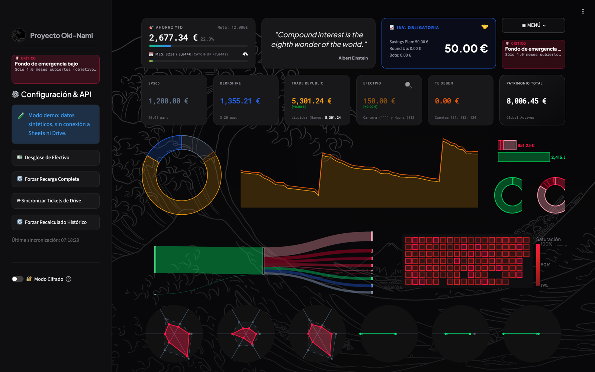
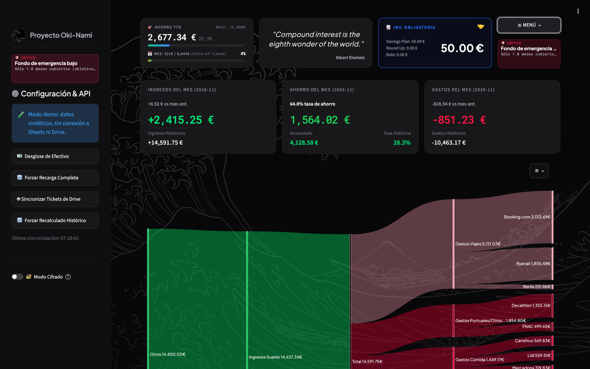
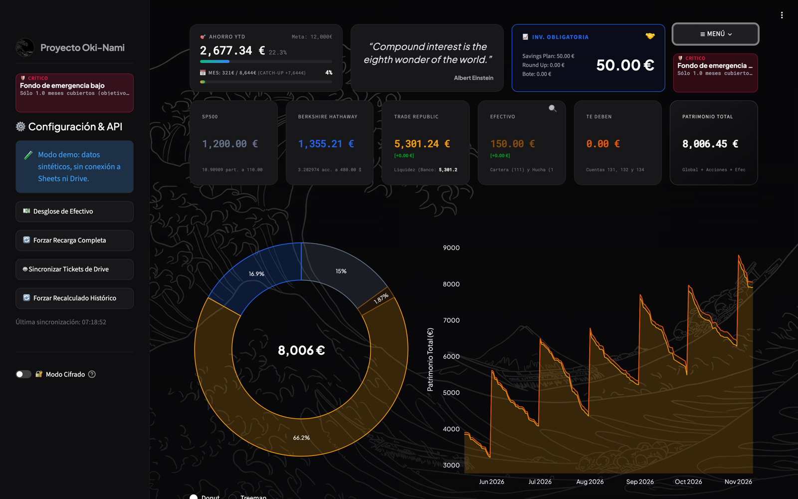

# Oki-Nami

[](https://github.com/MiguelMartinVieira/oki-nami/actions/workflows/ci.yml)

My personal finance system, in use since April 2026. I run my own money on it, track what my parents and I owe each other, and keep the books for an NGO account I manage.

It's a double-entry ledger (Google Sheets as the database) with a Streamlit dashboard on top. The UI is in Spanish because I'm its only user.



> Screenshots come from `DEMO_MODE`: a synthetic, seeded ledger. No real data is in this repo.

## Why I built it

Budgeting apps treat money as a list of transactions. That breaks as soon as money moves between accounts that aren't strictly yours: cash my parents owe me, an NGO's funds held in my bank account, a card payment that is half mine. In double-entry, every movement is a balanced pair of entries, so balances always reconcile and "whose money is this?" has a precise answer.

## What it does

- **Double-entry ledger.** Every transaction is a debit/credit pair over a chart of accounts (assets 1xx, income 4x, expenses 5x). Balances, the cash-flow Sankey and net worth are all derived from the ledger, never typed in by hand.
- **Portfolio tracking.** Live prices from Yahoo Finance with a local CSV fallback when it rate-limits. Share counts are parsed from broker execution lines (`quantity: 0.133333`) instead of being entered manually.
- **Inflation-adjusted view.** Pulls Spain's CPI from the INE public API to show what spending and returns are worth in real terms.
- **Receipt OCR.** Receipt photos dropped into a Drive folder go through Gemini Vision. The amount, date and store are extracted, the file is renamed, and the entry is posted to the ledger.
- **Shared-account audit.** For money my parents owe me, every ledger entry is matched to a receipt in three passes (exact amount and date, then date only, then a "paid without receipt" Google Doc). The result is a monthly Excel/CSV report.
- **Analytics.** Z-score spending anomalies per category, detection of recurring subscriptions by interval regularity, cost per day / hours of work per category, and a Monte Carlo net-worth projection with P10–P90 bands.
- **iOS widget.** Exports a small JSON of metrics that a Scriptable widget reads.

| Cash flow | Portfolio |
|---|---|
|  |  |

## Run it

```bash
git clone https://github.com/MiguelMartinVieira/oki-nami.git
cd oki-nami
uv sync
DEMO_MODE=true uv run streamlit run Dashboard/src/app.py
```

`DEMO_MODE` serves a synthetic ledger and synthetic prices. It doesn't call any API and blocks every write. To use your own data, copy `.env.example` to `.env` and point it at a Google Sheet plus a service account. Everything else is optional.

There is also a `CIPHER_MODE` toggle in the sidebar that keeps real data but masks every number, so I can show the app on a screen-share.

## Layout

```
Dashboard/src/
  data/        Google Sheets, Yahoo Finance, INE CPI — I/O only, Parquet cache
  services/    accounting, receipt auditing, OCR extraction, analytics
  components/  charts and cards shared by tabs
  tabs/        one package per dashboard tab
Dashboard/tests/  pytest suite, runs offline in CI
```

Deployment is Docker Compose with Caddy in front for TLS (`docker-compose.yml`, `Caddyfile`). Locally it runs as a macOS app (`scripts/setup_startup_mac.sh`).

## Notes

- I build this together with AI coding agents. `AGENTS.md` is the brief they work from: which agent owns which directory and which tests it has to pass before a change counts.
- This is a personal tool, not a product: the account numbers and categories fit my finances. The ledger logic and the demo are general enough to read through and reuse.
